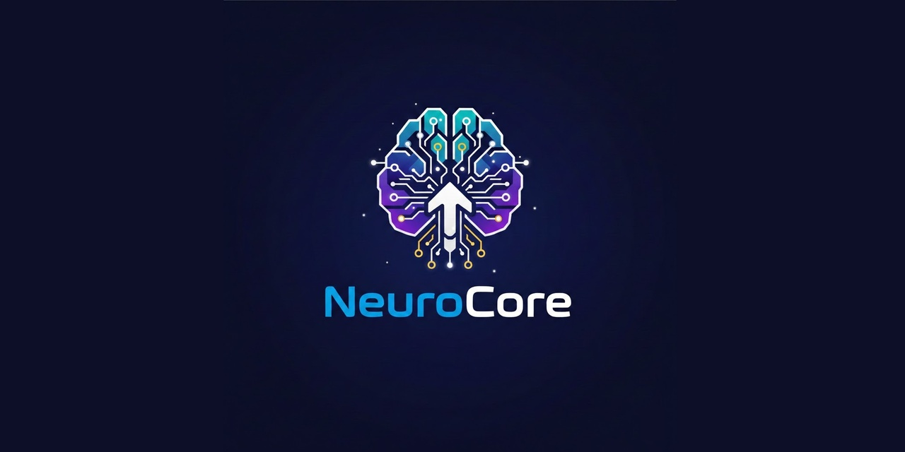

# NeuroCore

<!-- aegean:media:start -->
<p align="center"></p>
<p align="center"><a href="LICENSE"></a> <a href="https://github.com/AegeanWorks/AIKit"></a></p>
<!-- aegean:media:end -->

<p align="center">
</p>

<p align="center">
  <a href="https://python.org"></a>
  <a href="https://fastapi.tiangolo.com"></a>
  <a href="https://htmx.org"></a>
  <a href="https://tailwindcss.com"></a>
  <a href="LICENSE"></a>
</p>

<h3 align="center">
  A complete, self-hosted AI agent framework.<br>
  Visual flow editor · Persistent memory · RAG · Tools · Multi-platform messaging · Community marketplace.
</h3>

---

## ⚡ 30-Second Cold-Start Quick Reference

- **Runtime Prerequisites**: Python 3.12+ and git.
- **Canonical Regression Shield Gate**:
  ```bash
  python -m pytest
  ```

### 🛠️ AIKit Commands (run from the AIKit folder)
| Role | Command |
|---|---|
| Status, task and gates | `python aikit.py status neurocore` |
| Phase 4: every gate | `python aikit.py check neurocore` |
| Repair memory and map, then check | `python aikit.py fix neurocore` |
| Resume an interrupted task | `python aikit.py resume neurocore` |

---

## 🚀 Quick Start

```bash
# 1. Clone & install
git clone https://github.com/Aegean-E/NeuroCore
cd NeuroCore
pip install -r requirements.txt

# 2. Point to your LLM (edit settings.json)
# "llm_api_url": "http://localhost:1234/v1"

# 3. Run
python main.py
# Windows convenience: start.bat runs the same command from its own folder.

# 4. Open http://localhost:8000
```

Or with Docker:
```bash
docker-compose up -d --build
```

Docker keeps all mutable state in `./data` (`NEUROCORE_STATE_DIR=/app/data`) and
mounts `./modules` so module configuration survives container recreation. The image holds
runtime dependencies only and runs as an unprivileged user; if your host user is not UID 1000,
start it with `NEUROCORE_UID=$(id -u) NEUROCORE_GID=$(id -g) docker-compose up -d --build`.
Compose publishes on `127.0.0.1` only and therefore sets
`NEUROCORE_ALLOW_UNAUTHENTICATED_REMOTE=1`; set `NEUROCORE_API_TOKEN` and drop that flag before
publishing on any other interface.
Browser automation additionally needs its browser binaries:

```bash
playwright install chromium
```

---

## 📦 What's Inside

```text
neurocore/
├── .aikit/               <- AIKit project memory: ledger, guidelines, decisions
├── .dockerignore
├── .github/
├── .gitignore
├── CLAUDE.md
├── COMMERCIAL.md         <- commercial terms (ACL-1.0)
├── Dockerfile
├── LICENSE
├── LICENSES/             <- REUSE license texts
├── REUSE.toml            <- Machine-readable SPDX metadata
├── README.md
├── start.bat
├── docker-compose.yml
├── main.py               <- FastAPI application entrypoint
├── pyproject.toml        <- package metadata & dependencies
├── requirements.txt      <- runtime + optional capabilities (mirrors pyproject.toml)
├── requirements-dev.txt  <- adds the test tools
├── core/                 <- engine, flow manager, runner, observability
├── data/                 <- runtime state (ignored; only the directory is tracked)
├── docs/                 <- architectural guides & module docs
├── modules/              <- hot-swappable functional modules
├── screenshots/          <- UI and feature captures
├── tests/                <- automated pytest test suite
└── web/                  <- frontend templates and static assets
```

---

## 🏗️ Architecture

NeuroCore is organized into **four clean, decoupled layers:**

1. **Presentation Layer**: HTMX + Jinja2 (39 templates) + TailwindCSS.
2. **Core Layer**: DAG flow engine (`flow_runner.py`), validated flow evolution (`flow_evolution.py`), module hot-swapper (`module_manager.py`), observability and tracing (`observability.py`), and settings.
3. **Module Layer**: 21 self-contained modules (`agent_loop`, `brain`, `memory`, `knowledge_base`, `tools`, `messaging_bridge`, `planner`, etc.).
4. **Data Layer**: SQLite (WAL + FTS5) + FAISS (`IndexFlatIP`) vector search.

### Flow Engine

Workflows are directed acyclic graphs executed deterministically using Kahn's topological sort and component bridge groups for parallel data sharing.

Every top-level run carries an execution budget: node executions, LLM calls, tokens, tool calls
and wall time. Nested and bridged runs share the parent allowance, and a flow's
`metadata.budget` may lower (never raise) a limit. Exhaustion stops the run with a precise
message; the defaults live in `budget_max_nodes`, `budget_max_llm_calls`, `budget_max_tokens`,
`budget_max_tool_calls` and `budget_max_seconds`. `GET /ai-flow/{id}/simulate` performs a
deterministic pre-flight analysis without running anything: dangling connections, unknown node
types, isolated nodes, cycles, external effects and a cost envelope against the budget. A single
pass that cannot fit blocks; a cycle that may reach a cap is reported as a warning.

A node can opt into retries: `retry_count` (0-4), `retry_delay`, `retry_max_delay` and
`retry_backoff` in its config. Retries are off by default because nodes may have side effects; only
timeouts, connection errors and retryable LLM statuses (408/425/429/5xx) qualify, and each attempt
spends one node from the run budget. `timeout_seconds` adds a per-node ceiling. Latency is timed per
module/type; `GET /debug/node-latency` (debug mode) reports p50/p95/p99 and stalls above
max(2 s, 3x p99); detection never aborts the run.

Skill documents are versioned: every content change stores the exact text under its SHA-256 in a
bounded 50-version history. `GET /api/skills/{id}/versions` lists them,
`GET /api/skills/{id}/versions/{n}` returns one with content, and
`POST /api/skills/{id}/rollback/{n}` restores it as a new version.

### Meta-Flows

Small flows are ganglia; a meta-flow joins them through pathways. Inline composition namespaces
each member's nodes (`g<index>__<id>`), rewires edges and bridges, adds pathway connections, and
validates the union as one executable flow. Live composition instead creates one `meta:subflow`
ganglion node per member and member-level pathways, so later edits to a member propagate. The
`Subflow (Ganglion)` node runs the referenced flow and guards against cycles and excess depth.
Metadata records `kind: meta_flow`, the mode, ganglia and pathways. Members with multiple
entry/exit nodes need explicit pathways; cycles and unknown endpoints are rejected.
`AgentService.compose_meta_flow` composes flows the agent owns, and the planner emits a
`COMPOSE_FLOW` action from structured `member_flows` metadata or from two or more flow ids in a
combine/compose/merge request; `live` selects reference-based composition.

### Loops

A cycle in a flow is a bounded loop, not an error: the default flow's tool loop is
`LLM → Conditional Router → Tool Dispatcher → LLM`. The runner re-runs a node whenever its inputs
change, up to `max_node_loops` (Settings, default 100), and enters each cycle at the node fed from
outside it. Set `"strict_cycle_mode": true` on a flow to reject cycles instead. Agent-proposed
edits (below) must stay acyclic.

The agent loops (standard, RLM and hybrid; goal pursuit inherits hybrid) carry a repetition guard:
normalized tool-call signatures (only transport IDs such as `request_id` and `trace_id` are
removed, never a domain `id`) detect three identical calls or an A-B-A-B oscillation. The first
detection injects a `change approach` message; the second aborts the episode with
`agent_loop_error` and `loop_detected` in the result and trace. Reading many different records
with the same tool does not trip it.

### Self-Evolution

`core/flow_evolution.py` is the only write path for agent-initiated flow edits. A proposal is
validated for required node keys, unique ids, edge endpoints, self-loops, duplicate edges, graph
acyclicity, size and the agent's node-type and tool allowlists, then saved through the shared
`FlowManager`, which snapshots the previous state. `history` and `rollback` make every edit
auditable and reversible; the agent exposes `evolve_flow` and `rollback_flow` and keeps its flow
cache in sync. The agent can execute an owned flow through `FlowRunner`; actions without a flow id
fall back to the first existing active chat flow, explicit ids must be owned, active or the default
chat flow, and `activate_flow` makes an owned flow the first active flow. Flow lists are ordered by
last edit (`updated_at`) while creation time is preserved. `evolve_and_evaluate` runs an edit
against a test input and auto-reverts when it fails; gateway metadata can submit structured flow
operations with that input. `propose_evolution` asks the configured LLM for a bounded operation
list, and `propose_and_evolve` applies it through the same validation and evaluation path. The
authenticated human gateway remains a later phase.
Ownership metadata and `reverted_nodes` survive save, restart and rollback.
Arbitrary Python, settings or module-code edits stay outside this path. The agent remains disabled
by default until the human gateway and its authentication are defined.

### AI Brain (observe/suggest)

The `brain` module is the control substrate for a neocortex-style loop. It composes a real
self-model from live flows, module manifests, memory, knowledge-base, metrics and evaluation
state; failures are reported as provider errors rather than mock values. An in-process event bus
feeds a bounded cognitive scheduler, and `observe` cycles record state while `suggest` cycles add
pending proposals. Autonomous actuation (`auto`) is not implemented yet.

`GET /brain/state`, `GET /brain/events`, `POST /brain/start|stop|cycle|mode` and
`POST /brain/events` expose the substrate. `POST /brain/eval/run` runs the deterministic echo
suite (or a supplied flow id), `POST /brain/eval/baseline` (admin) promotes the last result if it is perfect, and
`GET /brain/eval/status` compares current against baseline. The brain is experimental and ships
**disabled**: enable it on the Modules page (or set `"enabled": true` in
`modules/brain/module.json`); even then `auto_start` stays false until you call `/brain/start`.

Outcome learning mirrors experiences into the shared memory store: `POST /brain/learn` records
an action outcome, `POST /brain/learn/consolidate` turns repeated **training** successes into
`RULE` skills, and `POST /brain/learn/recall` reports held-out precision, recall and MRR.
Consolidation also distils repeated failures into bounded `[avoid]` knowledge that a later
success does not erase.
`POST /brain/learn/suggest {"query": "..."}` returns the skills worth reusing and the past
failures to verify before retrying.
`GET /brain/learn/status` and `GET /brain/learn/experiences` expose the ledger.
`POST /brain/goals/review` reviews active goals read-only: overdue, stale, low-clarity and
near-duplicate. Evidence links are exposed by
`GET /memory/links/{id}`, `POST /memory/links` and `POST /memory/links/{id}/accept`; a
contradiction scan (`GET /memory/contradictions`, `POST /memory/contradictions/scan`) is a
deterministic prefilter that only creates proposals for review. Evaluation runs
also record per-task outcomes for the same learning loop.

While the brain is running, ordinary chat/flow executions emit an outcome through
`core/outcomes.py` and become `flow:<id>` experiences; evaluations opt out to avoid double
counting and `/brain/stop` disables capture (`capture_flow_outcomes` turns it off entirely).

Self-improvement is explicit and eval-gated: `POST /brain/improve/candidates` accepts a flow
operation list (or `/improve/generate` drafts one), `/improve/evaluate` runs the candidate on an in-memory
copy, and promotion requires an admin, a **perfect same-flow baseline** with provenance, a perfect
candidate and no latency regression. `/improve/rollback` restores the snapshot; `/improve/status`
reports candidates and quotas (configured in `modules/brain/module.json`). Every candidate names
an active goal (`goal_id`) or declares `goal_kind: "self_repair"` with a reason; the link is
revalidated at promotion and the goal becomes `in_progress`. `require_goal_link` (default true)
controls the operator path.

Evaluation is read-only by construction: flows with state-mutating or external-effect nodes
(tools, memory writes, messaging, calendar, subflows) are rejected with `UnsafeEvaluationError`
before execution.

Self-configuration is policy-gated: `/brain/config/preview` shows a before/after diff,
`/brain/config/apply` requires an admin, and `/brain/config/rollback` restores the snapshot
(newer changes for the same target must be rolled back first). Only whitelisted settings,
allowlisted modules and bounded brain options are editable; protected modules, API keys and
secrets are rejected, and `allowed_tools` can only be narrowed. Changes go to the configuration
ledger and `GET /brain/config/status`; the daily quota lives in `modules/brain/module.json`. A
configuration operation follows the goal rule: `goal_id`, or `goal_kind: "self_repair"` + `reason`.

The governance kernel derives a risk score from provider errors, evaluation pass rate, drift, a
one-hour window of blocked actions and a one-hour per-component error window, then runs in
`normal`, `degraded` or `safe`. Failed flows and evaluations feed the component window and a later
success cancels one entry, so an outage cannot hold the brain down. SAFE blocks learning writes,
improvement and configuration; rollback remains available.
`GET /brain/kernel` reports mode, inputs, windows and gates; `/kernel/kill` and `/kernel/reset`
require an admin. Leaving NORMAL starts a 60-second dwell during which a single clean snapshot
cannot return to NORMAL; a kill switch or manual reset bypasses it. Escalation follows raw risk
immediately; release uses persisted 0.1 smoothing and a stale value expires with the error window.
`POST /brain/drift/baseline` records a measured baseline for drift comparison.

Guardrails inspect untrusted text with local, deterministic rules (no network or LLM): context
separators and instruction overrides on chat input and knowledge-base chunks, credential shapes on
every surface, and verbatim system-prompt echoes on output. `brain_guardrail_mode` is `observe`
(default: report and count) or `enforce` (block an injected message or document, replace a leaked
response). A credential is flagged on input without rewriting the user's text and redacted from
output and tool results in both modes. `GET /brain/guardrails/status` reports counters and
`POST /brain/guardrails/scan` runs a scan without affecting anything.

Reactivity turns calendar events, watched files, metric thresholds and event-API calls into
proposal-only reactions. `GET /brain/reactions`, `/reactions/dismiss|mute|unmute` manage them;
`/react/start|stop|poll` control polling. They are deduplicated, muted, capped hourly, blocked
outside normal/degraded modes except health alerts, and never act.

Brain ledgers take a per-file cross-process lock and reload before each mutation.

One daily ceiling covers self-modification: candidates, evaluations, promotions, configuration
changes, prompt activation and automatic learning writes. Counts persist and reset at UTC midnight;
a denied reservation changes nothing and returns 429. `GET /brain/budget/status` reports counts,
caps and remaining units (`self_budget_caps`; defaults 50/50/10/20/20/500).

A bounded trend detector keeps 100 pass-rate/provider-error samples, compares the last 20 with the
previous 20 once a day, and turns a 0.10 regression into a reviewable `repair_metric` proposal
(one per day, no flow edits). `GET /brain/trends` shows the window and findings; thresholds live in
`modules/brain/module.json`.

Brain audit identity comes from the request, not from an `approved_by` JSON field. Loopback and
test clients are trusted as `local` admins (or the optional `X-Brain-Actor` label). Remote clients
must present a token in `X-Brain-Token`: either `NEUROCORE_BRAIN_TOKEN` (shared admin override) or a
token from the actor registry. `GET /brain/actor` reports the resolved actor.

Actor management is admin-only (`GET/POST /brain/actors`, rotate/disable/delete). Tokens are
returned once as `<key_id>.<secret>`, stored as salted PBKDF2 hashes, and selected by key id so a
check costs one hash. Roles: `viewer` (read-only), `operator` (learning, reactions, evaluation,
cycles) and `admin` (promotions, configuration, kernel, baselines, actors). Protected operations
record the actor name.

`/brain/ui` is the local Brain dashboard: kernel mode/risk, health, cycle status, proposals,
reactions, evaluation and start/stop/kill/reset controls. It appears
in the navbar when `brain` is enabled and refreshes every five seconds.

---

## 🧩 Available Modules & Capabilities

- **`agent_loop`**: Autonomous goal pursuit with RLM reasoning and tool calls.
- **`brain`**: Observe/suggest self-model, event bus, cognitive scheduler and evaluation scorecard.
- **`memory`**: Semantic memory storage and hybrid vector recall with FAISS. Memory evidence links
  (`supports`, `contradicts`, `derived_from`, `supersedes`) carry a Laplace-smoothed confidence;
  contradiction candidates are found by a deterministic prefilter and stored as reviewable
  proposals, never applied automatically. Recall promotes one hop of accepted `supports` or
  `derived_from` evidence; `recall_link_boost` (default 0.5, 0 disables) bounds it.
- **`knowledge_base`**: Document RAG with hybrid search (FAISS + SQLite FTS5) and Reciprocal Rank Fusion.
- **`messaging_bridge`**: Unified multi-platform bridge supporting Telegram, Discord, Signal, and WhatsApp.
- **`tools`**: 23 built-in tools executed in an isolated process sandbox with network policy controls.
- **`planner`**: Multi-step request decomposition and dependency-aware step tracking.
- **`browser_automation`**: Headless browser automation service using Playwright.
- **`calendar`**: Calendar event tracking and proactive deadline reminders.
- **`autonomous_agent`** *(experimental, disabled)*: Standalone runtime with sandboxed flow creation, three-tier memory, reflection and chat buffering. It is not auto-loaded; see `ADR-008` before enabling it.

---

## 🌐 API Reference

Over 70 endpoints provide REST and SSE access:
- **Dashboard & System**: `GET /`, `GET /dashboard/stats`, `GET /llm-status`
- **Flows**: `GET /ai-flow`, `POST /ai-flow/save`, `POST /ai-flow/{id}/run-node/{nid}`
- **Modules**: `GET /modules/list`, `POST /modules/{id}/config`, `POST /modules/{id}/{action}`
- **Marketplace**: `GET /marketplace`, `POST /marketplace/upload`, `POST /marketplace/item/{id}/import`
- **Tracing**: `GET /debug/logs`, `GET /debug/events`, `GET /debug/summary`

---

## 🧪 Testing

```bash
# Install test tools (runtime requirements plus pytest plugins)
pip install -r requirements-dev.txt

# Run test suite
python -m pytest

# Run with coverage
python -m pytest --cov=.
```

---

## 🔒 Security Defaults

NeuroCore is a control plane with no authentication, so it stays local by default. Remote
access, the auto-reloader and secret-bearing exports are each an explicit opt-in:

| Environment variable | Default | Effect when set |
|---|---|---|
| `NEUROCORE_STATE_DIR` | project root | Store settings, flows, chats and calendar events, plus every data file (databases, decoder key, traces, uploads, brain ledgers), in one directory (Docker uses `/app/data`); unset, data files stay in `data/` |
| `NEUROCORE_HOST` | `127.0.0.1` | Bind another interface (Docker uses `0.0.0.0` inside the container) |
| `NEUROCORE_PORT` | `8000` | Bind another port |
| `NEUROCORE_RELOAD` | off | Enable uvicorn auto-reload |
| `NEUROCORE_ALLOWED_HOSTS` | loopback only | Accept extra `Host` names |
| `NEUROCORE_API_TOKEN` | unset | Token non-loopback clients must send (`X-API-Token` or `Authorization: Bearer`); a non-loopback bind refuses to start without it |
| `NEUROCORE_ALLOW_UNAUTHENTICATED_REMOTE` | off | Allow a non-loopback bind without a token, only when an outer layer (e.g. a loopback port publish) already keeps the app local |
| `NEUROCORE_BRAIN_TOKEN` | unset | Required for all remote `/brain/*` access; send `X-Brain-Token`, optional `X-Brain-Actor` |
| `NEUROCORE_EXPORT_SECRETS` | off | Include secrets in the config export |

State-changing requests are rejected when their `Origin` is cross-origin (CSRF). Destructive
routes also require the exact `confirm` phrase, so an API caller cannot bypass the dialog.
Marketplace packages are extracted through a path-confined helper, and secrets are stripped from config
exports and masked in debug logs. Tool code runs in a separate worker process (never in-process)
with allowlisted imports, only the environment values listed in the tools module's
`env_allowlist`, and a network allowlist that re-checks every redirect and caps response size.
On NeuroCore's own port a tool may call only `/memory/goals` and `/browser_automation/api/`, so
tool code cannot change settings or install modules through the token-free loopback API.

Literature search is restricted to three allowlisted adapters (Wikipedia, arXiv, PubMed) in
`core/research_gateway.py`. Each request, and each redirect hop, must stay on that source's hosts
and resolve to a public address; responses are capped at 2 MB and 10 seconds, cached for a day,
and returned with the source, retrieval time, licence and a content hash. `GET /research/sources`
lists the adapters and `POST /research/fetch {"source","query","limit","persist"}` performs a
search; there is no fallback to an unlisted search engine or a spoofed user agent.
These are defense-in-depth Python restrictions, not an OS isolation boundary: do not run
untrusted community tools on a machine whose files or credentials you cannot afford to expose.

<!-- aegean:brand-assets:start -->
## 🎨 Brand Assets

> **AI-Generated Brand Artwork.** The banner and logo are **AI-generated brand assets**. They are illustrative and may not literally depict every feature or the full project scope.
<!-- aegean:brand-assets:end -->

## 📜 License

Free for personal use under the Aegean License 1.1 (AL-1.1); see [LICENSE](LICENSE). Any commercial use needs the Aegean Commercial License 1.0 (ACL-1.0); see [COMMERCIAL.md](COMMERCIAL.md).
