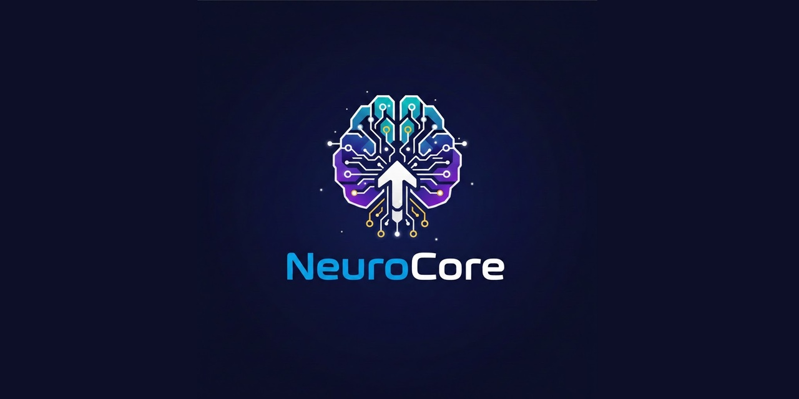

# NeuroCore

<!-- aegean:media:start -->
<p align="center"></p>
<p align="center"><a href="LICENSE"></a> <a href="https://github.com/AegeanWorks/AIKit"></a></p>
<!-- aegean:media:end -->

<p align="center">
  <a href="https://python.org"></a>
  <a href="https://fastapi.tiangolo.com"></a>
  <a href="https://htmx.org"></a>
  <a href="https://tailwindcss.com"></a>
  <a href="LICENSE"></a>
</p>

<h3 align="center">
  A complete, self-hosted AI agent framework.<br>
  Visual flow editor · Persistent memory · RAG · Tools · Multi-platform messaging · Community marketplace.
</h3>

---

## ⚡ 30-Second Cold-Start Quick Reference

- **Runtime Prerequisites**: Python 3.12+ and git.
- **Canonical Regression Shield Gate**:
  ```bash
  python -m pytest
  ```

### 🛠️ AIKit Commands (run from the AIKit folder)
| Role | Command |
|---|---|
| Status, task and gates | `python aikit.py status neurocore` |
| Phase 4: every gate | `python aikit.py check neurocore` |
| Repair memory and map, then check | `python aikit.py fix neurocore` |
| Resume an interrupted task | `python aikit.py resume neurocore` |

---

## 🚀 Quick Start

```bash
# 1. Clone & install
git clone https://github.com/Aegean-E/NeuroCore
cd NeuroCore
pip install -r requirements.txt

# 2. Point to your LLM (edit settings.json)
# "llm_api_url": "http://localhost:1234/v1"

# 3. Run
python main.py
# Windows convenience: start.bat runs the same command from its own folder.

# 4. Open http://localhost:8000
```

Or with Docker:
```bash
docker-compose up -d --build
```

Docker keeps all mutable state in `./data` (`NEUROCORE_STATE_DIR=/app/data`) and
mounts `./modules` so module configuration survives container recreation. The image holds
runtime dependencies only and runs as an unprivileged user; if your host user is not UID 1000,
start it with `NEUROCORE_UID=$(id -u) NEUROCORE_GID=$(id -g) docker-compose up -d --build`.
Compose publishes on `127.0.0.1` only and therefore sets
`NEUROCORE_ALLOW_UNAUTHENTICATED_REMOTE=1`; set `NEUROCORE_API_TOKEN` and drop that flag before
publishing on any other interface.
Browser automation additionally needs its browser binaries:

```bash
playwright install chromium
```

`settings.json` can declare per-model request ceilings under `model_limits`:

```json
"model_limits": {
  "local-model": {"max_output_tokens": 4096, "max_context_tokens": 32768}
}
```

`LLMBridge` clamps `max_tokens`, refuses a prompt that exceeds the context ceiling instead of
truncating it, and attaches `_clamp` to a clamped chat response. Models without an entry pass
through unchanged unless `strict_model_limits` is `true`; an empty `model_limits` mapping disables
the check entirely.

---

## 📦 What's Inside

```text
neurocore/
├── .aikit/               <- AIKit project memory: ledger, guidelines, decisions
├── .dockerignore
├── .github/
├── .gitignore
├── CLAUDE.md
├── COMMERCIAL.md         <- commercial terms (ACL-1.0)
├── Dockerfile
├── LICENSE
├── LICENSES/             <- REUSE license texts
├── REUSE.toml            <- Machine-readable SPDX metadata
├── README.md
├── assets/               <- brand media (logo and social preview)
├── start.bat
├── docker-compose.yml
├── main.py               <- FastAPI application entrypoint
├── pyproject.toml        <- package metadata & dependencies
├── requirements.txt      <- runtime + optional capabilities (mirrors pyproject.toml)
├── requirements-dev.txt  <- adds the test tools
├── core/                 <- engine, flow manager, runner, observability
├── data/                 <- runtime state (ignored; only the directory is tracked)
├── docs/                 <- architectural guides & module docs
├── modules/              <- hot-swappable functional modules
├── screenshots/          <- UI and feature captures
├── tests/                <- automated pytest test suite
└── web/                  <- frontend templates and static assets
```

---

## 🏗️ Architecture

NeuroCore is organized into **four clean, decoupled layers:**

1. **Presentation Layer**: HTMX + Jinja2 (39 templates) + TailwindCSS.
2. **Core Layer**: DAG flow engine (`flow_runner.py`), validated flow evolution (`flow_evolution.py`), module hot-swapper (`module_manager.py`), observability and tracing (`observability.py`), and settings.
3. **Module Layer**: 21 self-contained modules (`agent_loop`, `brain`, `memory`, `knowledge_base`, `tools`, `messaging_bridge`, `planner`, etc.).
4. **Data Layer**: SQLite (WAL + FTS5) + FAISS (`IndexFlatIP`) vector search.

### Flow Engine

Workflows are directed acyclic graphs executed deterministically using Kahn's topological sort and component bridge groups for parallel data sharing.

Every top-level run carries an execution budget: node executions, LLM calls, tokens, tool calls
and wall time. Nested and bridged runs share the parent allowance, and a flow's
`metadata.budget` may lower (never raise) a limit. Exhaustion stops the run with a precise
message; the defaults live in `budget_max_nodes`, `budget_max_llm_calls`, `budget_max_tokens`,
`budget_max_tool_calls` and `budget_max_seconds`. `GET /ai-flow/{id}/simulate` performs a
deterministic pre-flight analysis without running anything: dangling connections, unknown node
types, isolated nodes, cycles, external effects and a cost envelope against the budget. A single
pass that cannot fit blocks; a cycle that may reach a cap is reported as a warning.

A node can opt into retries: `retry_count` (0-4), `retry_delay`, `retry_max_delay` and
`retry_backoff` in its config. Retries are off by default because nodes may have side effects; only
timeouts, connection errors and retryable LLM statuses (408/425/429/5xx) qualify, and each attempt
spends one node from the run budget. LLM failures are typed: 401/403 auth, 402 budget, 429 rate
limit with `Retry-After`, and context-window 400/413/422. Auth, context and budget errors are never
retried, and a `Retry-After` hint overrides exponential backoff up to `retry_max_delay`.
`timeout_seconds` adds a per-node ceiling. Latency is timed per
module/type; `GET /debug/node-latency` (debug mode) reports p50/p95/p99 and stalls above
max(2 s, 3x p99); detection never aborts the run.

Skill documents are versioned: every content change stores the exact text under its SHA-256 in a
bounded 50-version history. `GET /api/skills/{id}/versions` lists them,
`GET /api/skills/{id}/versions/{n}` returns one with content, and
`POST /api/skills/{id}/rollback/{n}` restores it as a new version.

Skill content is scanned by the guardrails before it is stored. `enforce` refuses a
prompt-injection finding with the rule ids and a Why/Fix; `observe` (the default) stores the skill
with a `scan` record (`verdict`, `mode`, `content_sha256`, `findings`, `scanned_at`). A
content-changing update re-scans, and URL imports use the same admission path.

### Meta-Flows

Small flows are ganglia; a meta-flow joins them through pathways. Inline composition namespaces
each member's nodes (`g<index>__<id>`), rewires edges and bridges, adds pathway connections, and
validates the union as one executable flow. Live composition instead creates one `meta:subflow`
ganglion node per member and member-level pathways, so later edits to a member propagate. The
`Subflow (Ganglion)` node runs the referenced flow and guards against cycles and excess depth.
Metadata records `kind: meta_flow`, the mode, ganglia and pathways. Members with multiple
entry/exit nodes need explicit pathways; cycles and unknown endpoints are rejected.
`AgentService.compose_meta_flow` composes flows the agent owns, and the planner emits a
`COMPOSE_FLOW` action from structured `member_flows` metadata or from two or more flow ids in a
combine/compose/merge request; `live` selects reference-based composition.

### Loops

A cycle in a flow is a bounded loop, not an error: the default flow's tool loop is
`LLM → Conditional Router → Tool Dispatcher → LLM`. The runner re-runs a node whenever its inputs
change, up to `max_node_loops` (Settings, default 100), and enters each cycle at the node fed from
outside it. Set `"strict_cycle_mode": true` on a flow to reject cycles instead. Agent-proposed
edits (below) must stay acyclic.

The agent loops (standard, RLM, hybrid; goal pursuit inherits hybrid) carry a repetition guard on
normalized tool-call signatures (transport ids removed, never a domain `id`): three identical
calls or an A-B-A-B oscillation inject `change approach` first and abort with
`agent_loop_error`/`loop_detected` at the second. Reading many records with one tool does not
trip it.
The same loops re-hash the leading system prefix before each model call; if compaction or a tool
step changed it, the prefix is restored and `integrity_violation` is recorded
(`modules/agent_loop/prompt_digest.py`; ADR-070). A summary appended after the prefix is allowed.

Episode checkpoints carry an id, parent, source, step and a request/model/tools digest; resuming
needs a matching digest (or `resume_any`), else the old episode pauses (ADR-085). Tool calls are
journaled `pending` before dispatch and `done` after, so a resume replays finished calls but
never reruns an interrupted non-idempotent tool (`tool_journal_policy`; ADR-086).

With `step_journal_enabled`, each committed node is journaled by `run_id` and input digest, so a
retry runs only the uncommitted suffix; a duplicate `_idempotency_key` attaches and an interrupted
effectful node raises `IncompleteStep` unless `_resolve_incomplete` (ADR-087). Completed episodes
expire on two clocks; `prune_episodes(dry_run=True)` quarantines them and bumps `generation` on
id reuse (ADR-088). Outcomes emitted inside a trace carry `trace_id`, `span_id` and
`parent_span_id`; sampling is decided once at the root (ADR-099).

### Self-Evolution

`core/flow_evolution.py` is the only write path for agent-initiated flow edits. A proposal is
validated for required keys, unique ids, edge endpoints, self-loops, duplicate edges, acyclicity,
size and the node-type/tool allowlists, then saved through `FlowManager`, which snapshots the
previous state. `history` and `rollback` make every edit
auditable and reversible; the agent exposes `evolve_flow` and `rollback_flow` and keeps its flow
cache in sync. The agent can execute an owned flow through `FlowRunner`; actions without a flow id
fall back to the first existing active chat flow, explicit ids must be owned, active or the default
chat flow, and `activate_flow` makes an owned flow the first active flow. Flow lists are ordered by
last edit (`updated_at`) while creation time is preserved. `evolve_and_evaluate` runs an edit
against a test input and auto-reverts when it fails; gateway metadata can submit structured flow
operations with that input. `propose_evolution` asks the configured LLM for a bounded operation
list, and `propose_and_evolve` applies it through the same validation and evaluation path. The
authenticated human gateway remains a later phase.
Ownership metadata and `reverted_nodes` survive save, restart and rollback. Arbitrary Python,
settings or module-code edits stay outside this path.

### AI Brain (observe/suggest/autonomous)

The `brain` module is the control substrate for a neocortex-style loop. It composes a real
self-model from live flows, module manifests, memory, knowledge-base, metrics and evaluation
state; failures are reported as provider errors rather than mock values. An in-process event bus
feeds a bounded cognitive scheduler, and `observe` cycles record state while `suggest` cycles add
pending proposals. `autonomous` cycles also act on the proposals that have an allow-listed
action (record a baseline, review a failing evaluation, consolidate learning, check recall),
at most `max_autonomous_actions_per_cycle` (default 2) per cycle, each behind the kernel (SAFE
forces `observe`) and one unit of the daily self-budget; every attempt is journaled. Proposals
without such an action (repair a provider, activate a flow, seed memory) wait for the user.

`GET /brain/state`, `GET /brain/events`, `POST /brain/start|stop|cycle|mode` and
`POST /brain/events` expose the substrate. `POST /brain/eval/run` runs the deterministic echo
suite (or a supplied flow id), `POST /brain/eval/baseline` (admin) promotes the last result if it is perfect, and
`GET /brain/eval/status` compares current against baseline. The brain is experimental and ships
**disabled**: enable it on the Modules page (or set `"enabled": true` in
`modules/brain/module.json`); even then `auto_start` stays false until you call `/brain/start`.
The mode you choose and whether you started it are remembered: a brain that was running resumes
at the next server start, and an explicit Stop stays stopped. When the brain is enabled, the chat
page also carries a compact brain rail beside the conversation: mode, kernel, health, cycles and
pending proposals, with start/stop/cycle controls and a link to the full cockpit. While the module
is off the rail offers an **Enable brain** action, and chat keeps running through the active flow
unchanged. A message that starts with `/brain` is answered by the brain conversation (state-aware
reply plus allow-listed command suggestions) but lands in the same chat session and SSE stream;
suggestions render as buttons that run through `/chat/sessions/{id}/brain/commands` using the same
allow-list as `/brain/commands`. Ordinary messages keep running through the active flow, and a
brain failure is reported in the transcript without taking chat down. Ordinary flow turns also
receive a compact brain-state block through `_brain_context` when the brain is enabled; flows that
use the System Prompt node render it as medium-priority internal context. Set
`inject_flow_context` to `false` in `modules/brain/module.json` to turn that off. `/brain/ui`
remains the cockpit for kernel, proposals, reactions and evaluation; it links to Chat instead of
hosting a second conversation, while `GET/POST /brain/chat` stays available to API clients.

Outcome learning mirrors experiences into memory: `POST /brain/learn` records an outcome,
`/learn/consolidate` turns repeated **training** successes into `RULE` skills, and
`/learn/recall` reports held-out precision, recall and MRR. Consolidation also distils failures
into bounded `[avoid]` knowledge. `POST /brain/learn/suggest {"query": "..."}` returns reusable
skills and failures to verify; `/learn/status` and `/learn/experiences` expose the ledger.
`POST /brain/goals/review` reviews active goals read-only: overdue, stale, low-clarity and
near-duplicate. Evidence links are exposed by
`GET /memory/links/{id}`, `POST /memory/links` and `POST /memory/links/{id}/accept`; a
contradiction scan (`GET /memory/contradictions`, `POST /memory/contradictions/scan`) is a
deterministic prefilter that only creates proposals for review. Evaluation runs
also record per-task outcomes for the same learning loop.

While the brain is running, ordinary chat/flow executions emit an outcome through
`core/outcomes.py` and become `flow:<id>` experiences; evaluations opt out to avoid double
counting and `/brain/stop` disables capture (`capture_flow_outcomes` turns it off entirely).

Self-improvement is explicit and eval-gated: `POST /brain/improve/candidates` accepts a flow
operation list (or `/improve/generate` drafts one), `/improve/evaluate` runs the candidate on an in-memory
copy, and promotion requires an admin, a **perfect same-flow baseline** with provenance, a perfect
candidate and no latency regression. `/improve/rollback` restores the snapshot; `/improve/status`
reports candidates and quotas (configured in `modules/brain/module.json`). Every candidate names
an active goal (`goal_id`) or declares `goal_kind: "self_repair"` with a reason; the link is
revalidated at promotion and the goal becomes `in_progress`. `require_goal_link` (default true)
controls the operator path.

Prompts can be versioned with `modules/brain/prompt_registry.py`: an immutable version per
content digest, a rollout as a label move, an auditable rollback (ADR-100).

Evaluation is read-only by construction: flows with state-mutating or external-effect nodes
(tools, memory writes, messaging, calendar, subflows) are rejected with `UnsafeEvaluationError`
before execution. Each check is typed and weighted (`required` failures stay binding), each run
carries a content-addressed `suite_digest`, and a changed suite compares as incomparable rather
than as a regression or an improvement (ADRs 095/096).

Self-configuration is policy-gated: `/brain/config/preview` diffs, `/brain/config/apply` needs an
admin, and `/brain/config/rollback` restores the snapshot. Only whitelisted settings, allowlisted
modules and bounded brain options are editable; protected modules, API keys and secrets are
rejected, and `allowed_tools` can only narrow. Changes go to the config ledger
(`GET /brain/config/status`; quota in `modules/brain/module.json`), with a `goal_id` or
`goal_kind: "self_repair"` + `reason`.

The governance kernel derives risk from provider errors, evaluation pass rate, drift, blocked
actions and per-component errors over one hour, then runs in `normal`, `degraded` or `safe`. A later success cancels one component entry, so an outage cannot hold the brain down. SAFE blocks learning
writes, improvement and configuration; rollback stays available.
`GET /brain/kernel` reports mode, inputs and gates; `/kernel/kill` and `/kernel/reset` require an
admin. Leaving NORMAL starts a 60-second dwell a single clean snapshot cannot cross; a kill switch
or manual reset bypasses it. Escalation follows raw risk, release uses 0.1 smoothing.
`POST /brain/drift/baseline` records a drift baseline.

Guardrails inspect untrusted text with local, deterministic rules (no network or LLM): context
separators and instruction overrides on chat input, knowledge-base chunks and every memory or goal
write, credential shapes on every surface, and verbatim system-prompt echoes on output.
`brain_guardrail_mode` is `observe` (default: report and count) or `enforce` (block an injected
message, document, memory or goal, replace a leaked response). A credential is flagged on input without rewriting the user's text and redacted from
output and tool results in both modes. Every tool result sent to a model and every retrieved
knowledge chunk is fenced as data in an `<untrusted_content_<random id>>` block naming its source
(`core/untrusted.py`), so text inside cannot pass for instructions or close its own block.
`GET /brain/guardrails/status` reports counters and
`POST /brain/guardrails/scan` runs a scan without affecting anything.

Reactivity turns calendar events, watched files, metric thresholds and event-API calls into
proposal-only reactions (`GET /brain/reactions`, `/reactions/dismiss|mute|unmute`,
`/react/start|stop|poll`): deduplicated, capped hourly, blocked outside normal/degraded modes
except health alerts, and never acting.

Brain ledgers take a per-file lock and reload before each write.

One daily ceiling covers self-modification: candidates, evaluations, promotions, config changes,
prompt activation and learning writes. Counts persist and reset at UTC midnight; a denied
reservation changes nothing and returns 429. `GET /brain/budget/status` reports counts, caps and
remaining units (`self_budget_caps`; defaults 50/50/10/20/20/500).

A bounded trend detector keeps 100 pass-rate/provider-error samples, compares the last 20 with the
previous 20 daily, and turns a 0.10 regression into one `repair_metric` proposal per day
(`GET /brain/trends`; thresholds in module config).

Brain audit identity comes from the request, not an `approved_by` field. Loopback and test clients
are `local` admins (or the optional `X-Brain-Actor` label); remote clients must present
`X-Brain-Token` (`NEUROCORE_BRAIN_TOKEN` or an actor token); `GET /brain/actor` reports it.

Actor management is admin-only (`GET/POST /brain/actors`, rotate/disable/delete). Tokens return
once as `<key_id>.<secret>`, stored as salted PBKDF2 hashes, selected by key id. Roles: `viewer`,
`operator` (learning, reactions, evaluation, cycles) and `admin` (promotions, config, kernel,
baselines, actors); protected operations record the actor.

`/brain/ui` is the local Brain page: mode switch (observe, suggest, autonomous), chat, log,
kernel risk, health, cycles and proposals. `POST /brain/chat` answers with live state and may name
commands from a fixed list; autonomous mode runs them, otherwise each returns a Run button
(`POST /brain/commands`). An allow-listed proposal gets that button; one needing a person links to
Settings, AI Flow or Memory. The navbar always shows **Brain**.

---

## 🧩 Available Modules & Capabilities

- **`agent_loop`**: Autonomous goal pursuit with RLM reasoning and tool calls.
- **`brain`**: Observe/suggest self-model, event bus, cognitive scheduler and evaluation scorecard.
- **`memory`**: Semantic memory storage and hybrid vector recall with FAISS. Memory evidence links
  (`supports`, `contradicts`, `derived_from`, `supersedes`) carry a Laplace-smoothed confidence;
  contradiction candidates are found by a deterministic prefilter and stored as reviewable
  proposals, never applied automatically. Recall promotes one hop of accepted `supports` or
  `derived_from` evidence; `recall_link_boost` (default 0.5, 0 disables) bounds it.
- **`knowledge_base`**: Document RAG with hybrid search (FAISS + SQLite FTS5) and Reciprocal Rank
  Fusion. Each collection stamps its embedding space `(model, revision, dimension, normalization)`
  and refuses an ingestion or query from another space. IVF search sets `nprobe`, over-fetches and
  rescores exactly (`kb_recall_budget`; ADR-090).
- **`messaging_bridge`**: Unified multi-platform bridge supporting Telegram, Discord, Signal, and WhatsApp.
- **`tools`**: 23 built-in tools executed in an isolated process sandbox with network policy controls.
- **`planner`**: Multi-step request decomposition and dependency-aware step tracking.
- **`browser_automation`**: Headless browser automation via Playwright. `snapshot` returns
  bounded element ids; `click_element`/`type_element` verify an observable change and report
  `done`, `unverified`, `stale_element` or `policy_refused`; page reads are budgeted and refuse
  rather than cut (ADRs 097/098).
- **`calendar`**: Calendar event tracking and proactive deadline reminders.
- **`autonomous_agent`** *(experimental, disabled)*: Standalone runtime with sandboxed flow creation, three-tier memory, reflection and chat buffering; delegation is bounded by `core/delegation.py` and handoffs track acceptance with retries (`core/handoff.py`; ADRs 101/102). Not auto-loaded; see `ADR-008`.

---

## 🌐 API Reference

Over 70 endpoints provide REST and SSE access:
- **Dashboard & System**: `GET /`, `GET /dashboard/stats`, `GET /llm-status`
- **Flows**: `GET /ai-flow`, `POST /ai-flow/save`, `POST /ai-flow/{id}/run-node/{nid}`
- **Modules**: `GET /modules/list`, `POST /modules/{id}/config`, `POST /modules/{id}/{action}`
- **Marketplace**: `GET /marketplace`, `POST /marketplace/upload`, `POST /marketplace/item/{id}/import`
- **Tracing**: `GET /debug/logs`, `GET /debug/events`, `GET /debug/summary`

---

## 🧪 Testing

```bash
# Install test tools (runtime requirements plus pytest plugins)
pip install -r requirements-dev.txt

# Run test suite
python -m pytest

# Run with coverage
python -m pytest --cov=.
```

A flow test can record a real provider exchange once and replay it without a model:

```python
from core.llm import LLMBridge

record = LLMBridge(
    base_url="http://localhost:1234/v1",
    cassette_mode="record",
    cassette_path="tests/fixtures/provider.json",
)
# Run the flow once; every chat call and completed stream is appended to the cassette.

replay = LLMBridge(
    base_url="http://localhost:1234/v1",
    cassette_mode="replay",
    cassette_path="tests/fixtures/provider.json",
)
```

`cassette_match` chooses `structural` (the default: endpoint, model, roles and tool schema),
`strict` (the whole body, so a prompt edit fails with the changed keys) or `loose` (endpoint
only). Prompts are stored as a digest and shape, never as text; responses pass the credential
redaction before they are written.

---

## 🔒 Security Defaults

NeuroCore is a control plane with no authentication, so it stays local by default. Remote
access, the auto-reloader and secret-bearing exports are each an explicit opt-in:

| Environment variable | Default | Effect when set |
|---|---|---|
| `NEUROCORE_STATE_DIR` | project root | Store settings, flows, chats and calendar events, plus every data file (databases, decoder key, traces, uploads, brain ledgers), in one directory (Docker uses `/app/data`); unset, data files stay in `data/` |
| `NEUROCORE_HOST` | `127.0.0.1` | Bind another interface (Docker uses `0.0.0.0` inside the container) |
| `NEUROCORE_PORT` | `8000` | Bind another port |
| `NEUROCORE_RELOAD` | off | Enable uvicorn auto-reload |
| `NEUROCORE_ALLOWED_HOSTS` | loopback only | Accept extra `Host` names |
| `NEUROCORE_API_TOKEN` | unset | Token non-loopback clients must send (`X-API-Token` or `Authorization: Bearer`); a non-loopback bind refuses to start without it |
| `NEUROCORE_ALLOW_UNAUTHENTICATED_REMOTE` | off | Allow a non-loopback bind without a token, only when an outer layer (e.g. a loopback port publish) already keeps the app local |
| `NEUROCORE_BRAIN_TOKEN` | unset | Required for all remote `/brain/*` access; send `X-Brain-Token`, optional `X-Brain-Actor` |
| `NEUROCORE_EXPORT_SECRETS` | off | Include secrets in the config export |

State-changing requests with a cross-origin `Origin` are rejected (CSRF); destructive routes need
the exact `confirm` phrase.
Marketplace packages are extracted through a path-confined helper; secrets are stripped from
config exports and masked in logs. Tool code runs in a separate worker with allowlisted imports,
only `env_allowlist` values, and a redirect-rechecking network allowlist.
On its own port a tool may call only `/memory/goals` and `/browser_automation/api/`, so it cannot
change settings or install modules through the token-free loopback API.
Every tool call is LOW (run), MEDIUM (run and log) or HIGH (hold) from the manifest's
`tier`/`tier_reason`, never the model's prose; an unknown or reasonless tier is HIGH.
`GET /tools/approvals` lists held calls; `POST /tools/approvals/{id}/run?confirm=run this tool` (or
`/reject`) settles one under a lock, at most once.

Every messaging bridge is deny-by-default: only senders in `<platform>_allowed_senders` and,
when set, rooms in `<platform>_allowed_chats` are admitted; legacy Telegram/Discord ids seed the
lists, Signal/WhatsApp need one. A denial logs only the platform id.

Memory is scoped by `user_id`/`agent_id`/`run_id` on read and write (`memory_scope_policy`
`strict`/`shared`, `memory_scope_required` refusal; `migrate_scope()` backfills); a selective
filter is planned first (ADR-089). The recalled block is bounded by
`recall_max_total_chars`/`recall_max_item_chars` with a `_memory_budget` receipt (ADR-093), and
an edit receipt backs `GET /memory/{id}/history` and a head/hash-checked
`POST /memory/edits/{id}/undo` (ADR-094).

A manifest declares its primitives (`requires`) and source file; an unknown or unsupported
primitive or a missing file is refused before the tier gate (`GET /tools/capabilities`; ADR-091).
Each call is cancellable (`POST /tools/calls/{id}/cancel`); a stopped run returns a `status`
receipt with no `result` (ADR-092).

A tool policy adds ordered, default-deny rules: set `tool_policy_file` and `tool_policy_mode`
(`observe` default, or `enforce`). The first match decides `allow`, `deny` or `require_approval`;
no match denies, and a denial names the rule, version, risk and digest. Matchers are exact tool
names (`tool_in`), path containment (`path_prefix`) and dot-bounded host suffixes (`host_in`); a
malformed argument is a non-match. `allow` cannot lower a tier, so a HIGH call is still held.
Format: `docs/TOOL_GUIDE.md`.

Literature search is restricted to three allowlisted adapters (Wikipedia, arXiv, PubMed) in
`core/research_gateway.py`. Each request and redirect hop must stay on that source's hosts and
resolve to a public address, and connects to the address it checked (`core/pinned_http.py`; the
skill importer too), so DNS rebinding cannot swap in a private address; responses are capped at
2 MB/10 s with source, time, licence and hash. `GET /research/sources` lists the adapters and
`POST /research/fetch {"source","query","limit","persist"}` searches; there is no fallback to an
unlisted engine.
These are defense-in-depth Python restrictions, not an OS isolation boundary: never run untrusted
community tools where files or credentials must stay private.

<!-- aegean:brand-assets:start -->
## 🎨 Brand Assets

> **AI-Generated Brand Artwork.** The banner and logo are **AI-generated brand assets**. They are illustrative and may not literally depict every feature or the full project scope.
<!-- aegean:brand-assets:end -->

## 📜 License

Free for personal use under the Aegean License 1.1 (AL-1.1); see [LICENSE](LICENSE). Any commercial use needs the Aegean Commercial License 1.0 (ACL-1.0); see [COMMERCIAL.md](COMMERCIAL.md).
